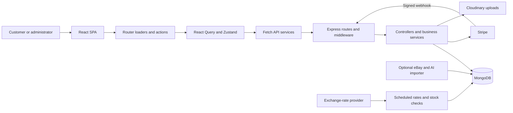
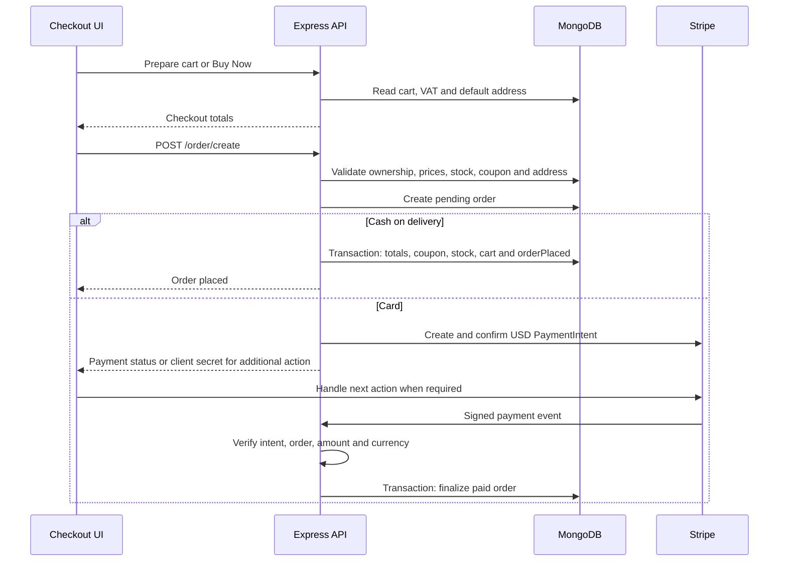

<div align="center">

# ShopLite

### Full-stack electronics storefront & store administration

Browse products and variants, manage a customer account, place orders with cash on delivery or Stripe, and operate the catalog from a dedicated admin interface.

**React · Express · MongoDB · Stripe · Tailwind CSS**

[Features](#implemented-features) · [Architecture](#architecture-and-techniques) · [Local setup](#local-setup) · [API](#api-overview) · [Limitations](#current-limitations)

</div>

---

## Overview

ShopLite is a JavaScript e-commerce application focused on electronics: laptops, smartphones, tablets, headphones, smart watches, computer and gaming accessories, smart-home products, monitors, and cameras. The name appears in the storefront header and admin settings; some informational copy still uses “Shoply.”

The repository contains three independently installed Node.js applications:

- **Storefront and admin SPA:** React pages for public browsing, authenticated shopping, account management, and administration.
- **REST API:** Express routes, Mongoose models, business services, Stripe integration, media uploads, and scheduled tasks.
- **Optional catalog tooling:** an eBay importer with AI enrichment, product normalization, generated demonstration reviews, and separate database maintenance scripts.

This README describes the checked-in implementation. Features below are backed by source code; external services and complete purchase flows have not been verified against live accounts. Static UI and incomplete behavior are identified separately.

## Contents

- [Implemented features](#implemented-features)
- [Technology stack and tools](#technology-stack-and-tools)
- [Architecture and techniques](#architecture-and-techniques)
- [Key workflows](#key-workflows)
- [Repository structure](#repository-structure)
- [Local setup](#local-setup)
- [Environment variables](#environment-variables)
- [API overview](#api-overview)
- [Testing and verification](#testing-and-verification)
- [Deployment](#deployment)
- [Current limitations](#current-limitations)

## Implemented features

### Customer experience and product discovery

| Feature | Implemented behavior | Source |
| --- | --- | --- |
| Data-driven landing page | Active categories, best sellers, new arrivals, top-rated products, a most-wishlisted collection, and expiring variant deals. Deal banners rotate and show countdowns. The most-wishlisted query has a schema mismatch noted below. | [Home API](E-commerce-backend/controllers/Home.js), [home page](E-commarce-frontend/src/Pages/HomePage.jsx), [deal banner](E-commarce-frontend/src/components/Landing/DealsBannerSection.jsx) |
| Catalog search and filters | Search across title, description, category name, brand, and tags; filter category, brands, tags, price range, deals, top-rated items, and best sellers. The API also exposes a separate five-result search endpoint. | [shop controller](E-commerce-backend/controllers/shop.js), [filter hook](E-commarce-frontend/src/hooks/useShopFilters.jsx) |
| Sorting and pagination | Price, date, rating, and alphabetical sorting; server-side skip/limit pagination and result counts. Filter and page state is encoded in URL query parameters. Some flag combinations override sorting priorities. | [shop controller](E-commerce-backend/controllers/shop.js), [URL query hook](E-commarce-frontend/src/hooks/UrlQuery.jsx), [shop page](E-commarce-frontend/src/Pages/ShopPage.jsx) |
| Product details | Image gallery, descriptions, specifications, rating display, shipping information, return-policy information, and related-product queries. Opening a product increments its view count. | [product page](E-commarce-frontend/src/Pages/ProductPage.jsx), [detail components](E-commarce-frontend/src/components/ProductDetails), [detail hook](E-commarce-frontend/src/hooks/useProductDetails.jsx) |
| Variant-aware selection | Select available product attributes, display variant prices and stock, prioritize variant images, and open a variant through `?variantId=...`. Attributes in the model include color, size, storage, RAM, and SSD. | [variant selector](E-commarce-frontend/src/components/ProductDetails/VariantSelector.jsx), [product model](E-commerce-backend/models/Product.js) |
| Reviews | Signed-in customers submit or update their product review. Submissions return to `pending`; only approved reviews appear publicly. Admin moderation recalculates rating summaries. The `verified` flag is set for a registered reviewer, not established by a purchase check. | [review hook](E-commarce-frontend/src/hooks/useProductReviews.jsx), [shop controller](E-commerce-backend/controllers/shop.js), [moderation controller](E-commerce-backend/controllers/adminReviews.js) |
| Responsive presentation | Mobile navigation, responsive product layouts, a mobile purchase bar, breadcrumbs, dialogs, loaders, empty-result messages, form feedback, and toast notifications. Individual screens handle their own loading/error states. | [header](E-commarce-frontend/src/components/Landing/Header.jsx), [mobile buy bar](E-commarce-frontend/src/components/ProductDetails/StickyMobileBuyBar.jsx), [shared components](E-commarce-frontend/src/components/genericComponents) |
| Currency display | USD, EUR, and EGP preferences, persisted locally through Zustand; rates are fetched from the API and used with `Intl.NumberFormat`. Stripe charges remain in USD. | [currency store](E-commarce-frontend/src/zustand_preferences/currency.jsx), [rate service](E-commarce-frontend/src/APIs/ExchangeRateService.js), [rate controller](E-commerce-backend/controllers/exchangeRate.js) |
| Contact and information | Store contact details from MongoDB, FAQs, informational About/privacy/terms sections, and a support form. Support submissions validate fields, map issue types to priorities, save a message, and create an admin notification. | [contact hook](E-commarce-frontend/src/hooks/useContactPage.jsx), [contact routes](E-commerce-backend/routes/contacts.js), [contact controller](E-commerce-backend/controllers/contacts.js), [About page](E-commarce-frontend/src/Pages/AboutPage.jsx) |

### Authentication and customer accounts

- **Email/password registration and login:** registration creates a customer with a bcrypt hash; login issues a JWT access token and a refresh-token cookie. Frontend route actions validate required credentials and password confirmation. Backend signup validation is limited.
- **Session restoration:** the application waits for `/auth/refresh` before rendering session-dependent navigation. Authenticated requests attach a bearer token, attempt refresh after a `401`, and retry the original request once.
- **Protected customer pages:** cart, checkout, and profile routes redirect unauthenticated visitors to login. Admin navigation points an admin account to the dashboard; API role checks enforce administrative access.
- **Profile overview:** customer statistics, recent orders, wishlist previews, and personal/contact details.
- **Personal information:** edit name, email, phone, date of birth, gender, location, biography, and avatar. Avatar files travel through Multer memory storage to Cloudinary. Profile/address validation errors map back to form fields.
- **Address book:** create, edit, delete, and select a default address. The address schema uses a partial unique index to allow only one default address per user. Checkout can direct the customer to the add-address form.
- **Order history:** paginated orders with debounced search, status tabs, payment labels, and product/total information.
- **Wishlist:** persist product/variant pairs, toggle items, clear the list, and add an item to the cart with pending/already-added button states.
- **Saved cards:** create Stripe SetupIntents, collect details through Stripe Payment Element, list masked card metadata, set a default card, and detach cards.
- **Password changes and logout:** compare the current password before saving a new hash; logout deletes the user's stored refresh-token records and clears the cookie. Refresh revocation currently has an implementation defect described below.

Sources: [router](E-commarce-frontend/src/router.jsx), [auth controller](E-commerce-backend/controllers/auth.js), [profile controller](E-commerce-backend/controllers/UserProfile.js), [payment-method controller](E-commerce-backend/controllers/UserProfilePayments.js), [profile sections](E-commarce-frontend/src/Sections/UserProfile).

### Shopping, cart, checkout, and payments

| Capability | Behavior |
| --- | --- |
| Persistent account cart | MongoDB stores cart items keyed by product and variant. Adding/updating sends the desired quantity; it does not increment an existing quantity automatically. Stock and variant availability are checked by the API. There is no guest-cart merge or local-storage cart. |
| Cart management | Change quantities, remove a variant, clear the cart, view item counts, savings, VAT, and totals. React Query caches cart data and attempts optimistic updates before invalidating cart/checkout queries. The optimistic rollback has known defects. |
| Coupon offers | Evaluate active dates, usage limits, customer history, cart value, order count, total spending, first-order eligibility, or specific-user assignment. Offer messages show eligibility or progress toward a coupon; suggestion history affects recommendation ranking. |
| Promotion application | Percentage, fixed-amount, and free-shipping coupons. Cart updates recalculate amount discounts; order creation revalidates the coupon and recalculates its benefit. Free shipping is finalized during order creation. |
| Regular checkout | Fetch the account cart, default address, saved cards, notes, and totals. VAT comes from database configuration; delivery prices match the normalized city, state, or country. Unsupported shipping locations are rejected when ordering. |
| Buy Now | Create a separate single-variant `BuyNowCart` for checkout. Preparing a new one replaces the user's previous Buy Now cart and preserves the regular cart. |
| Order validation | Validate payment type, address, cart ownership/type, item availability, stock, prices, and coupon rules. A changed price updates the cart and returns a conflict requiring review. |
| Cash on delivery | Create an order and finalize stock, customer totals, coupon usage, and cart removal inside a MongoDB transaction. Payment status is `not_required`. |
| Stripe card payments | Create and confirm a USD PaymentIntent with an order-specific idempotency key; return client action information for additional authentication or processing. Signed webhooks verify payment/order identity, amount, and currency before finalization. |
| Failure handling | Store payment failure details, attempt cancellation if the intent cannot be saved, and attempt an idempotent refund when a successful payment cannot be matched/finalized. These are server-side code paths, not live-service test results. |

Sources: [cart controller](E-commerce-backend/controllers/Cart.js), [cart service](E-commerce-backend/services/CartService.js), [coupon eligibility](E-commerce-backend/MiddleWare/CouponEligibilityCheck.js), [checkout controller](E-commerce-backend/controllers/checkout.js), [order controller](E-commerce-backend/controllers/order.js), [order service](E-commerce-backend/services/PlaceOrderService.js), [webhook](E-commerce-backend/controllers/stripeWebhook.js).

### Administration

All admin API groups require a bearer token and an admin role. Most controllers perform the role check themselves; notifications use explicit `isadmin` middleware. Admin browser routes are currently outside the customer protected layout.

| Area | Implemented operations |
| --- | --- |
| Dashboard | Revenue, orders, customer/product counts, comparison percentages, monthly revenue chart, order-status summaries, recent orders, top sellers, and low-stock alerts. |
| Products | Search, category/status filters, pagination, view/create/edit/delete dialogs, active/draft creation, image URLs, descriptions, specifications, SEO fields, tags, shipping/return metadata, variants, default variant, prices, and inventory summaries. |
| Categories | Create/edit/delete, active status, keywords, icon upload to Cloudinary, parent/ancestor relationships, descendant ancestor refresh, and attached-product counts. Deletion is blocked for categories with children or attached products. |
| Orders | Search and paginate orders, filter by order/payment status, inspect details, and update an order to a schema-supported status. Status updates alone do not implement a return, refund, or restocking workflow. |
| Customers | Search, paginate, filter status, sort by spending, inspect customer/order details, and change account status including blocking. Blocked customers cannot proceed through checkout/order creation or submit reviews. |
| Inventory | Paginated variant inventory and status filtering; edit stock and low/critical thresholds, recalculate availability and total product stock. |
| Coupons and discounts | Create/edit/delete coupons and variant discounts, configure dates/status/type/value, eligibility and usage limits, assign customer coupons, and paginate the coupon/discount lists independently. Discount operations update variant pricing metadata. |
| Reviews | Search and filter by status/rating, paginate, read comments, approve/reject, and delete. Approved-review aggregation updates product counts, averages, and rating breakdowns. |
| Analytics | Monthly revenue, order counts, customer joins, average order value, leading products, and category sales distribution, visualized with Recharts. |
| Activity logs | Display stored catalog, promotion, review, customer-status, and order-status activity with type-specific icons and relative time. Available UI event labels do not prove every label is emitted by the backend. |
| Notifications | List per-admin notifications, mark individual/all notifications read, and display an important-unread count. Events include orders, payment failures, signups, contact messages, reviews, and stock thresholds. Stock checks run after connection and every 120 minutes, with duplicate detection. |
| Settings | Edit admin profile/avatar/password and store contact/settings fields. Store shipping-setting/schema inconsistencies are documented under limitations. |

Sources: [admin pages](E-commarce-frontend/src/Pages), [admin hooks](E-commarce-frontend/src/hooks), [admin controllers](E-commerce-backend/controllers), [stock task](E-commerce-backend/services/stockNotificationsTask.js), [activity logging](E-commerce-backend/services/CreateActivityLogs.js).

### Optional catalog and demonstration-data tooling

The [importer](ebay-importer-advanced/src/index.js) searches eBay categories, deduplicates and filters candidates, shuffles results, retrieves details, maps products, enriches tags/attributes/review data through an AI service, writes output files, and creates or updates MongoDB products. Reviews are stored separately and linked back to products.

- [eBay service](ebay-importer-advanced/src/services/ebay.service.js): cached client-credentials OAuth token, Browse API requests, timeouts, request spacing, and retry with exponential backoff for network errors, `429`, and server errors.
- [Mappers](ebay-importer-advanced/src/mappers): product normalization, generated variants/SKUs, enrichment, pricing/inventory fields, and image metadata.
- [AI service](ebay-importer-advanced/src/services/ai.service.js): calls the OpenAI Responses endpoint through Axios and requests JSON. Generated reviews/ratings are demonstration data, not customer feedback or verified purchases.
- [Maintenance utilities](ebay-importer-advanced/src): customer/order generation, category attachment, review-schema changes, stock/SKU repair, discount/date/status updates, and password-reset utilities. These are standalone data-changing scripts, not a unified seed/migration system.
- Older RapidAPI and ZenRows collection/enrichment scripts also exist under the backend. Their startup calls in `app.js` are commented out.

## Technology stack and tools

Versions below are declared package ranges, not a claim that every installed copy has the same version. Each application includes an npm lockfile.

| Technology/tool | Declared version | Purpose and actual use |
| --- | --- | --- |
| JavaScript, Node.js, npm | No project-wide runtime pin | JSX/ES modules in the frontend; CommonJS API/importer; separate npm scripts and lockfiles. |
| React / React DOM | `^18.0.0` | Component UI, hooks, Strict Mode, DOM rendering. |
| React Router DOM | `^6.22.3` | Nested routes/layouts, loaders, actions, forms/fetchers, route metadata and navigation. |
| TanStack React Query | `^5.90.17` | Server-state cache, loader prefetch, conditional queries, mutations, invalidation, and optimistic updates. |
| Zustand | `^5.0.10` | Auth/session readiness, checkout UI state, shop search, persisted currency preferences. |
| Tailwind CSS / Vite plugin | `^4.1.18` | Responsive utility styling and CSS theme variables in [index.css](E-commarce-frontend/src/index.css). |
| Radix UI | `radix-ui ^1.4.3`; individual packages in manifest | Dialog, select, avatar, separator, slot, switch, tabs, toast, and tooltip primitives in reusable UI components. |
| CVA, clsx, tailwind-merge | `^0.7.1`, `^2.1.1`, `^3.5.0` | Component variants and class composition through [utilities](E-commarce-frontend/src/utils/utils.js). |
| Lucide React / Recharts | `^0.564.0` / `^3.8.1` | Icons and admin dashboard/analytics charts. |
| Stripe.js / React Stripe.js | `^8.9.0` / `^5.6.1` | Elements, saved-card setup, and additional payment authentication. |
| Vite / React plugin | `^7.2.4` / `^5.1.1` | Development server, Fast Refresh and production bundling; `@` resolves to `src`. |
| ESLint and React plugins | ESLint `^9.39.1` | Flat configuration, JavaScript, React Hooks and Fast Refresh checks. React type packages are installed, but the application is JavaScript, not TypeScript. |
| Express | `^5.2.1` | HTTP routing, JSON/raw-body parsing and centralized error middleware. |
| MongoDB / Mongoose | Mongoose `^9.1.1` backend; `^9.4.1` importer | Schemas, references/population, indexes, aggregation, updates and order-finalization transactions. |
| bcryptjs / jsonwebtoken | `^3.0.3` / `^9.0.3` | Password hashing/comparison and access/refresh JWTs. |
| express-validator | `^7.3.1` | Profile, address and support-form validation; other controllers use manual validation. |
| cors / cookie-parser / dotenv | `^2.8.6` / `^1.4.7` / `^17.3.1` backend | Credentialed cross-origin requests, refresh cookies and environment configuration. Importer dotenv is `^16.0.0`. |
| Multer / Cloudinary | `^2.0.2` / `^2.9.0` | In-memory multipart uploads for customer/admin avatars and category icons. Product editing uses image URLs. |
| Stripe Node SDK | `^20.4.0` | Customer/card operations, SetupIntents, PaymentIntents, signed webhooks and refunds. |
| Axios | `^1.13.2` backend; `^1.15.0` importer | Exchange-rate and catalog-service requests. Frontend APIs use browser `fetch`. |
| node-cron | `^4.2.1` | Daily database exchange-rate update; stock notifications use a separate interval timer. |
| Nodemon | `^1.18.4` | Backend development restart script. |
| eBay Browse API / AI enrichment | External services | Optional importer; not part of the normal storefront request path. |
| Cheerio / slugify | `^1.1.2` backend, `^1.2.0` importer / `^1.6.6` importer | Cheerio is used in legacy ZenRows HTML extraction; slugify is used in importer normalization. An importer dependency declaration alone does not establish active Cheerio use. |
| Git / Vercel configuration | No tool version pinned | Git history and npm lockfiles are present; frontend Vercel configuration rewrites SPA routes to `index.html`. No live deployment is established here. |

**Installed versus implemented:** `react-i18next` is referenced by the preferences UI, but no initialized translation resources were found. `i18next` and its browser language detector are installed. Legacy `react-query` v3 supplies an `isError` helper in the product-cart hook; server-state hooks/providers otherwise use TanStack v5. `sonner`, `toast`, backend Passport/Google/Facebook strategy packages, and `uuid` are declared without active application imports found during inspection. Their presence does not establish OAuth login or an email service. See the [frontend](E-commarce-frontend/package.json), [backend](E-commerce-backend/package.json), and [importer](ebay-importer-advanced/package.json) manifests for the complete dependency lists.

## Architecture and techniques

The application uses a React SPA and a single Express API with route/controller/model organization and shared business services. It does not demonstrate independent microservices or a strict Clean Architecture boundary.



| Technique | Concrete example |
| --- | --- |
| Page/logic separation | Pages compose sections and reusable UI; hooks such as [useAdminProductsPage](E-commarce-frontend/src/hooks/useAdminProductsPage.jsx) own requests, dialog state, search debounce and mutations. [APIs](E-commarce-frontend/src/APIs) encapsulates HTTP calls. |
| Reusable composition | Shared cards, forms, pagination, quantity controls, tables, badges, confirmation dialogs and [AdminLayout](E-commarce-frontend/src/components/admin/AdminLayout.jsx). Radix primitives support the component layer. |
| Router data APIs | [router.jsx](E-commarce-frontend/src/router.jsx) uses `ensureQueryData` in shop/product loaders, actions for authentication/profile/address/password forms, nested profile layouts and breadcrumb metadata. |
| URL as filter state | [UrlQuery.jsx](E-commarce-frontend/src/hooks/UrlQuery.jsx), parsing utilities and page-specific hooks synchronize filters, sort, search and pagination with the address bar. Several search fields debounce for 500 ms. |
| Server versus client state | React Query caches API data; Zustand holds session readiness, checkout selections and search. Only currency preferences use Zustand persistence. [queryClient.js](E-commarce-frontend/src/queryClient.js) defaults to five-minute staleness and disables focus refetch, with per-query overrides. |
| Mutation lifecycle | Card management and customer-status hooks snapshot cached data for optimistic updates and rollbacks. Cart mutations also attempt this technique but have implementation defects. Successful mutations invalidate related queries. |
| Request middleware | [isauth](E-commerce-backend/MiddleWare/isauth.js) verifies bearer JWTs; [getUser](E-commerce-backend/MiddleWare/getUser.js) loads the user document; blocked-account checks protect ordering; validation and upload middleware prepare requests. |
| Service extraction | [CartService](E-commerce-backend/services/CartService.js), [checkoutService](E-commerce-backend/services/checkoutService.js), [PlaceOrderService](E-commerce-backend/services/PlaceOrderService.js) and Stripe customer helpers centralize repeated business operations. Controllers still contain significant business logic. |
| Database relationships | Users reference orders, addresses, carts and reviews; wishlists embed product/variant pairs. Products embed variants and reference categories/reviews. Category parent/ancestor links model hierarchy. Variants are subdocuments rather than a separate collection. |
| Query and schema techniques | `lean`, `select`, `populate`, `distinct`, compound/unique/partial indexes, aggregation lookups/grouping/facets, parallel independent reads, and bulk stock updates. [Product](E-commerce-backend/models/Product.js) stores price/inventory/review summaries and assigns a default variant in a pre-validation hook. |
| Transactional order finalization | A conditional `pending` order claim and `session.withTransaction` group user totals, coupon consumption, cart removal, conditional stock decrements and final order state. Stripe calls occur outside this transaction. |
| Centralized and local errors | [app.js](E-commerce-backend/app.js) converts forwarded errors to `{ message, data }` with `statusCode` or `500`. Some controllers return their own bodies/status codes; response envelopes are not uniform. |
| Background and import resilience | Cron-based exchange-rate updates, interval-based deduplicated stock notifications, and importer retry/backoff plus token caching/request spacing. |

## Key workflows

### Authentication and session lifetime

1. A Router form action posts signup or login credentials. Signup hashes passwords with bcrypt cost `10`; login compares the hash and signs tokens using separate secrets.
2. The access token stays in a module variable in [AuthFetch.js](E-commarce-frontend/src/APIs/AuthFetch.js); Zustand holds user/session flags in memory. Neither is persisted to local storage.
3. Login stores a refresh-token document and sets an HTTP-only `refreshToken` cookie for seven days. Cookie options are `secure: true` and `sameSite: "none"` in production, otherwise `secure: false` and `sameSite: "lax"`.
4. [AuthInitializer](E-commarce-frontend/src/AuthInitializer.jsx) calls refresh on startup, showing a loading screen until authentication is resolved. `authFetch` includes credentials, attaches the access token, refreshes on `401`, and retries once.
5. Refresh verifies the refresh JWT and issues a new access token without rotating the refresh token. JWT expiry comes from environment settings; the cookie/database expiry is separately fixed at seven days.
6. Logout removes all refresh-token records for the user. **The refresh controller does not await `Token.findOne`, so its intended database revocation check is ineffective.** Do not interpret record deletion as verified session revocation.

### Cart and promotions

A product selection sends `{ productId, variantId, quantity }` to `POST /cart`. The API loads the variant, checks stock/availability, creates or updates the user's cart, calculates item totals and VAT, and stores the cart reference on the user. Existing-item quantity is replaced. Cart and checkout queries are invalidated after mutations; account persistence comes from MongoDB.

`GET /cart/cartPage` additionally evaluates coupon offers and records suggestion history. `PUT /cart/applyPromo` stores a matching offer and discount metadata. Quantity changes recalculate fixed/percentage discounts. Eligibility is checked again during order creation; cart-offer and order checks have some differences, so an offer is not a guarantee of acceptance.

### Checkout, payment, and persistence



The order stores a shipping-address snapshot, item prices/quantities, promo details, cart identifier, payment fields and a formatted order number. VAT is applied to the pre-discount item total; the discounted subtotal is floored at zero. Delivery configuration is read from `VAT_delivery.delivery` and matched against the address city/state/country.

Card success returned to the browser is not the finalization authority. [The webhook](E-commerce-backend/controllers/stripeWebhook.js) verifies the raw-body signature, matches the saved PaymentIntent and order, checks the amount in cents and USD currency, then invokes the transaction. Already placed/refunded orders are ignored on repeated success events. Conditional stock updates reject insufficient inventory. Failed finalization triggers a refund attempt; a refund failure propagates an error. There is no browser order-status polling flow or implemented payment-return route.

### Administration and moderation

Admin hooks send bearer-authenticated requests and refresh cached lists after mutations. Controllers check the admin role, normalize/validate payloads, update MongoDB and write activity records for supported operations. Category icon/admin avatar uploads use multipart form data and Cloudinary streams. Review approval/rejection/deletion rebuilds the product's approved-review summary. Customer blocking is stored on the user and checked during checkout/order/review requests; it does not globally disable login or every account endpoint.

Notifications are database records associated with administrators, read over HTTP rather than pushed through WebSockets. Some generated links point to detail/support pages that are not registered in the SPA.

## Repository structure

Directory spelling and capitalization below match the repository.

```text
.
├── README.md
├── Readme.txt                         # Existing empty file
├── E-commarce-frontend/
│   ├── public/                        # Product/artwork assets and SVG icons
│   ├── src/
│   │   ├── APIs/                      # Fetch services and authenticated fetch wrapper
│   │   ├── Pages/                     # Storefront, account and admin screens
│   │   ├── Sections/                  # Page sections and forms
│   │   ├── components/                # Product, cart, landing and reusable UI
│   │   ├── hooks/                     # Page logic, mutations, URL filters and formatting
│   │   ├── layouts/                   # Shared and protected customer layouts
│   │   ├── system/                    # Icons, UI data and Stripe initialization
│   │   ├── zustand_*/                 # Auth, checkout, search and currency stores
│   │   ├── utils/                     # URL parsing, pagination and text/class helpers
│   │   ├── router.jsx
│   │   └── queryClient.js
│   ├── vite.config.js
│   ├── eslint.config.js
│   └── vercel.json
├── E-commerce-backend/
│   ├── app.js                         # API mounts, CORS, DB connection and errors
│   ├── routes/                        # Express endpoint definitions
│   ├── controllers/                   # Customer/admin request handlers
│   ├── services/                      # Cart/order/payment helpers and background tasks
│   ├── models/                        # Mongoose schemas and relationships
│   ├── MiddleWare/                    # Authentication, validation, uploads, coupon checks
│   ├── Validation/                    # Profile and address validation chains
│   ├── config/                        # Cloudinary configuration
│   ├── getBaseProductsByRapidAPI/      # Legacy collection scripts
│   └── getEnrichedProductsInfoByZenRowsAPI/
└── ebay-importer-advanced/
    ├── src/
    │   ├── index.js                   # Import entry point
    │   ├── config/, data/, mappers/
    │   ├── models/, services/, utils/
    │   └── *.js                       # Standalone maintenance/demo-data utilities
    ├── output/                        # Tracked product datasets and backups
    └── .env.example                   # Outdated single-variable example
```

Each application has its own `package.json` and `package-lock.json`; there is no root npm workspace or combined startup script. Existing public images are individual assets, not verified application screenshots.

## Local setup

### Prerequisites

- Node.js and npm compatible with the locked packages. No `.nvmrc` or project runtime pin is present. Vite's locked package declares Node `^20.19.0 || >=22.12.0`; use a runtime satisfying the installed dependencies.
- A MongoDB database reachable by the API. **Order finalization requires a replica set or sharded deployment supporting transactions**; a standalone MongoDB instance is insufficient for that workflow.
- Stripe secret/publishable keys from the same account and mode for card features. A webhook signing secret and event forwarding are needed to finalize card orders locally.
- Cloudinary credentials for image uploads. Exchange-rate provider configuration/data for converted prices.

### Install and start

Run these commands from the repository root in two terminals. Create the environment files in the next section first. If PowerShell blocks `npm.ps1`, use `npm.cmd` in place of `npm`; no execution-policy change is necessary.

**Terminal 1 — backend**

```sh
cd E-commerce-backend
npm ci
npm run dev
```

The API connects to `MONGO_URI` before listening on `0.0.0.0`, port `3000` by default. `npm start` runs `node app.js` without Nodemon.

**Terminal 2 — frontend**

```sh
cd E-commarce-frontend
npm ci
npm run dev
```

Open the Vite URL printed in the terminal, normally `http://localhost:5173`. Use that origin for the backend client configuration. If Vite selects another port, add its origin to `CLIENT_URL`.

**Frontend build and preview**

```sh
cd E-commarce-frontend
npm run build
npm run preview
```

The build goes to `dist/`. Preview serves the built SPA and still requires a separately running API. There is no backend compilation step.

### Database initialization

There is no supported single-command seed for a clean installation. MongoDB collections are created by model writes; useful storefront data must be created/imported separately.

1. Register a customer through `/signup`. No public admin-registration endpoint or dedicated admin-bootstrap script exists. For a development database, explicitly assign the intended account `role: "admin"` in MongoDB, then log in again so the access token carries that role.
2. Add categories/products with active variants through admin operations or review the optional import tooling. Products need valid image data and default variants for the intended browsing/cart flows.
3. Initialize a `VAT_delivery` document matching [VAT.js](E-commerce-backend/models/VAT.js), including a fractional `vat` rate and `delivery: [{ place, cost }]`. For example, `vat: 0.14` represents 14%; this is an illustrative value, not a business/tax default. Delivery places must match the customer's city, state or country.
4. Initialize a complete `Store` document matching [storeInfo.js](E-commerce-backend/models/storeInfo.js) for contact details. Required fields include name, email, phone, address, city, state, country, zip code, working hours/days and holiday. The admin create-store path does not currently supply all of these fields.
5. Initialize USD exchange-rate data matching [ExchangeRate.js](E-commerce-backend/models/ExchangeRate.js), or allow the configured scheduled refresh to populate it. The immediate rate refresh is commented out; an empty database will not have rates on first startup.
6. Add a customer address and mark it default before placing an order. Save a card through the profile/payment interface when testing card checkout.

The separate [Store shippingFee field](E-commerce-backend/models/storeInfo.js) is not the delivery configuration used by checkout; checkout reads `VAT_delivery.delivery`.

### Local Stripe event delivery

Configure a Stripe development webhook or forward events with the Stripe CLI, if installed:

```sh
stripe listen --forward-to http://localhost:3000/api/stripe/webhook
```

Set the resulting development signing secret as `STRIPE_WEBHOOK_SECRET` and restart the backend. The handler processes `payment_intent.succeeded`, `payment_intent.payment_failed`, and `payment_intent.canceled`. The CLI is a local testing option, not a dependency or previously verified project tool.

### Optional importer

```sh
cd ebay-importer-advanced
npm ci
npm start
```

Configure the importer variables below before running it. This command calls external APIs and writes to MongoDB/output files; it is optional and is not needed to serve the application. Use a development dataset. The checked-in `.env.example` only lists `EBAY_TOKEN`, whereas the current service obtains OAuth tokens from client credentials and does not read that variable.

`node src/GenerateUsers.js` generates demonstration customers/orders, but it and the other standalone scripts use their own schemas and may assume older order/review shapes. Password reset and bulk-update scripts change existing records. Review each script and back up development data before using it; none were run for this README.

## Environment variables

Create `.env` in each owning application directory. Values below are safe placeholders; actual credentials are intentionally omitted. Frontend `VITE_` values are included in the browser build and must not contain secret keys.

### Frontend

| Variable | Required | Purpose / safe example |
| --- | --- | --- |
| `VITE_API_URL` | Yes | Backend origin without a global `/api` suffix: `http://localhost:3000`. Most API routes are mounted directly at the root. |
| `VITE_STRIPE_PUBLISHABLE_KEY` | For payment UI | Stripe publishable key, e.g. `pk_test_replace_me`. |

```dotenv
VITE_API_URL=http://localhost:3000
VITE_STRIPE_PUBLISHABLE_KEY=pk_test_replace_me
```

### Backend

| Variable | Required | Purpose / safe example |
| --- | --- | --- |
| `MONGO_URI` | Yes | MongoDB connection URI with database name and transaction-capable topology. |
| `PORT` | No | Listening port; default `3000`. |
| `CLIENT_URL` | For configured origins/payment return URL | Local value `http://localhost:5173`. CORS accepts comma-separated origins, but the Stripe return URL interpolates this value as one URL; use a single origin for that flow. Localhost `5173` is also allowed by code. |
| `NODE_ENV` | For deployment cookie behavior | Set `production` on an HTTPS deployment; controls refresh-cookie `secure` and `sameSite`. |
| `JWT_ACCESS_SECRET` | For authentication | Independent, private access-token signing secret. |
| `JWT_REFRESH_SECRET` | For authentication | Independent, private refresh-token signing secret. |
| `ACCESS_TOKEN_EXPIRES` | Configure for authentication | JWT lifetime, e.g. `15m`. No application default is supplied. |
| `REFRESH_TOKEN_EXPIRES` | Configure for authentication | JWT lifetime, e.g. `7d`. Cookie/record lifetime is separately fixed at seven days. |
| `STRIPE_SECRET_KEY` | Yes for current API initialization | Stripe SDKs are initialized when modules load; use a valid development key to start and test the current API. |
| `STRIPE_WEBHOOK_SECRET` | For card finalization | Signing secret for the receiving webhook endpoint, e.g. `whsec_replace_me`. |
| `CLOUD_NAME` | For uploads | Cloudinary cloud name. |
| `CLOUD_API_KEY` | For uploads | Cloudinary API key. |
| `CLOUD_API_SECRET` | For uploads | Cloudinary API secret. |
| `EXCHANGE_RATE_API_URL` | For scheduled conversions | Provider URL returning `{ conversion_rates: ... }` with a USD base. Do not expose any embedded provider key. |
| `RAPID_API_KEY` | Legacy tooling only | Credential read by the inactive RapidAPI collection script. |
| `ZENROWS_API_KEY` | Legacy tooling only | Credential read by the inactive ZenRows enrichment script. |

```dotenv
MONGO_URI=mongodb://127.0.0.1:27017/shoplite?replicaSet=rs0
PORT=3000
CLIENT_URL=http://localhost:5173
NODE_ENV=development
JWT_ACCESS_SECRET=replace_with_an_independent_random_secret
JWT_REFRESH_SECRET=replace_with_another_independent_random_secret
ACCESS_TOKEN_EXPIRES=15m
REFRESH_TOKEN_EXPIRES=7d
STRIPE_SECRET_KEY=sk_test_replace_me
STRIPE_WEBHOOK_SECRET=whsec_replace_me
CLOUD_NAME=replace_me
CLOUD_API_KEY=replace_me
CLOUD_API_SECRET=replace_me
EXCHANGE_RATE_API_URL=https://your-provider.example/usd-rates
```

The MongoDB example assumes an already configured local replica set named `rs0`; setting the URI alone does not create one. Placeholder service values must be replaced before the corresponding integrations can work.

### Optional importer and maintenance scripts

| Variable | Required | Purpose / default |
| --- | --- | --- |
| `MONGODB_URI` | For importer/scripts | Target database URI; spelling differs from backend `MONGO_URI`. |
| `EBAY_CLIENT_ID`, `EBAY_CLIENT_SECRET` | For import | eBay client-credentials OAuth. |
| `EBAY_MARKETPLACE_ID` | No | Defaults to `EBAY_US`. |
| `OPENAI_API_KEY` | For AI enrichment | Private enrichment-service credential. |
| `OPENAI_MODEL` | No | Model identifier; code default `gpt-5-mini`. |
| `TOTAL_PRODUCTS`, `PER_CATEGORY` | No | Collection caps, default `400` and `40`. |
| `EBAY_DELAY_MS` | No | Minimum eBay request spacing, default `500`. |
| `OUTPUT_DIR_PRODUCTS` | No | Default `output/products`. |
| `DB_NAME` | Script-dependent | Optional explicit database selection in maintenance/demo scripts. |
| `SEED_USER_PASSWORD`, `SEED_USER_PASSWORD_HASH` | Demo generation only | Generator configuration; a supplied hash must correspond to the intended password. The script uses the hash for stored credentials. |
| `CUSTOMER_RESET_PASSWORD_HASH` | Reset utility only | Hash used by the bulk customer password-reset script. |
| `SCRAPERAPI_API_KEY`, `SCRAPING_DELAY_MS`, `OUTPUT_DIR_REVIEWS` | No active consumer found beyond config | Declared configuration fields; do not imply a working ScraperAPI stage. Delay/output defaults are `2500` and `output/reviews`. |

## API overview

Paths are relative to the backend origin. **There is no universal `/api` prefix:** only the Stripe webhook is mounted under `/api`. Preserve the existing path spellings, including `analitics`, mixed capitalization and `setUpPaymentMethods`.

**Access:** Public = no auth middleware; User = valid bearer access token; Active checkout = bearer token plus a database blocked-account check; Admin = bearer token plus admin role; Stripe = signature-verified raw request.

### Public catalog and authentication

| Method | Path | Purpose | Access |
| --- | --- | --- | --- |
| GET | `/home` | Landing categories and product collections | Public |
| GET | `/shop/products` | Filtered/sorted/paginated catalog and filter options | Public |
| GET | `/shop/products/search/limited` | Up to five search results | Public |
| GET | `/shop/products/:id` | Product with approved reviews; increment views | Public |
| POST | `/shop/products/:id/reviews` | Create/update pending review; blocked users rejected | User |
| GET | `/contacts` | Store details and issue categories | Public |
| POST | `/contacts` | Validate/store support message and notify admins | Public |
| GET | `/exchangeRate` | Stored USD/EUR/EGP rates | Public |
| POST | `/auth/signup` | Create customer account | Public |
| POST | `/auth/login` | Access token and refresh cookie | Public |
| POST | `/auth/refresh` | Issue access token from refresh cookie | Refresh cookie |
| POST | `/auth/logout` | Delete user token records and clear cookie | User |

Catalog query names: `page`, `limit`, `category`, `brands`, `tags`, `minPrice`, `maxPrice`, `sort`, `onDeal`, `topRated`, `bestSeller`, `search`. The price-range branch requires both bounds and a nonzero maximum. Sort values include `price-asc`, `price-desc`, `newest`, `oldest`, `default`, `rating`, `Alphabetical`, and `ReverseAlphabetical`.

### Cart, checkout, and orders

| Method | Path | Purpose | Access |
| --- | --- | --- | --- |
| GET | `/cart` | Account cart/totals | User |
| POST | `/cart` | Add variant or replace its quantity | User |
| DELETE | `/cart` | Clear cart | User |
| DELETE | `/cart/:id?variantId=...` | Remove product/variant pair | User |
| GET | `/cart/cartPage` | Cart with coupon offer evaluation/history | User |
| PUT | `/cart/applyPromo` | Apply `promoCode` | User |
| GET | `/checkout` | Prepare regular checkout totals | Active checkout |
| GET | `/checkout/BuyNow` | Create Buy Now cart from `productId`, `variantId`, `quantity` | Active checkout |
| POST | `/order/create` | Create COD/card order from cart | Active checkout |
| POST | `/api/stripe/webhook` | Process signed payment success/failure/cancellation events | Stripe |

Order payload fields are `cartId`, `paymentType` (`cod` or `card`), `selectedCard` (required for card), and optional `orderNotes`. The shipping address is resolved from the user's default saved address, not accepted as a client-supplied order address.

### Account APIs

All paths below start with **`/user/profile`** and require a bearer token.

| Method | Suffix | Purpose |
| --- | --- | --- |
| GET | `/` | Profile summary, recent orders, statistics and wishlist preview |
| GET | `/personalInfo` | Editable personal information |
| POST | `/updatePersonalInfo` | Validated personal info and optional multipart `avatar` |
| GET | `/orders` | Orders with `page`, `limit`, `search`, `status` |
| GET | `/GetWishlist` | Variant-aware wishlist |
| POST | `/UpdateWishlist` | Toggle supplied product/variant pairs |
| DELETE | `/clearWishlist` | Empty wishlist |
| GET | `/addresses` | Address list |
| POST | `/updateAddress` | Create validated address |
| PUT | `/updateAddress/:id` | Update address |
| DELETE | `/deleteAddress/:id` | Remove address |
| PUT | `/SetAddressToDefault/:id` | Select default address |
| POST | `/setUpPaymentMethods` | Stripe SetupIntent client secret |
| GET | `/getPaymentMethods` | Saved cards and default status |
| PUT | `/setDefaultPaymentMethod/:id` | Set Stripe default card |
| DELETE | `/deletePaymentMethod/:id` | Detach Stripe payment method |
| PUT | `/changePassword` | Change password using current/new password |

### Admin APIs

Every row requires Admin access. `{id}` below is expressed as `:id` in Express routes.

| Method | Path | Purpose |
| --- | --- | --- |
| GET | `/admin/dashboard` | Dashboard aggregates |
| GET, POST | `/admin/products` | List/create products |
| GET, PUT, DELETE | `/admin/products/:id` | Read/update/delete product |
| GET, POST | `/admin/categories` | List/create categories; optional multipart `icon` |
| PUT, DELETE | `/admin/categories/:id` | Update/delete category |
| GET | `/admin/orders` | Search/filter/paginate orders |
| PUT | `/admin/orders/:id` | Update order status |
| GET | `/admin/customers` | Search/filter/paginate customers |
| GET, PUT | `/admin/customers/:id` | Customer details/status update |
| GET | `/admin/inventory` | Variant inventory and stock summaries |
| PUT | `/admin/inventory/:id` | Update variant stock/thresholds |
| GET | `/admin/coupons-discounts` | Independently paginated coupons/discounts |
| POST | `/admin/coupons-discounts/coupon` | Create coupon |
| PUT, DELETE | `/admin/coupons-discounts/coupon/:id` | Update/delete coupon |
| POST | `/admin/coupons-discounts/discount` | Create variant discount |
| PUT, DELETE | `/admin/coupons-discounts/discount/:id` | Update/delete discount |
| GET | `/admin/reviews` | Filtered/paginated reviews and statistics |
| PUT, DELETE | `/admin/reviews/:id` | Moderate/delete review |
| GET | `/admin/analitics` | Revenue, customer, product and category analytics |
| GET | `/admin/activity-logs` | Activity records |
| GET | `/admin/settings` | Admin/store settings |
| PUT | `/admin/settings/profile` | Admin personal info and multipart `image` |
| PUT | `/admin/settings/password` | Admin password change |
| PUT | `/admin/settings/store` | Store settings update |
| GET | `/admin/settings/TopBarInfo` | Admin top-bar identity |
| GET | `/admin/notifications` | Current admin notifications |
| PUT | `/admin/notifications/:id` | Mark notification read |
| PUT | `/admin/notifications/allNotifications` | Mark all read |
| GET | `/admin/notifications/ImportantUnreadNotificationsNumber` | Important-unread count |

List filters differ by resource: products use search/category/status; orders use search/status/paymentStatus; customers use search/status/spent; inventory uses status; reviews use search/status/rating. Coupon/discount pagination uses `CouponsPage`, `ProductsPage`, and `limit`. Refer to [routes](E-commerce-backend/routes) and [controllers](E-commerce-backend/controllers) for exact payloads and resource-specific envelopes.

### Responses and errors

- Catalog listing returns `{ products, pagination, category, brands, price, tags }`; pagination includes `totalItems`, `totalPages`, and `currentPage`. Admin pagination shapes vary.
- Many successes return `{ message, ...resource }`; signup returns text, login returns `{ accessToken, user }`, and some authentication failures are JSON strings or empty status responses.
- Shared form validation returns `400` with `{ errors: [...] }`, using field paths/messages from express-validator.
- JWT failures return `401`; admin/blocked-account rejection uses `403`. Controllers also use `404`, `409` for cart/stock/price conflicts, `422` for missing/unsupported shipping details, and `402` for payment failures.
- Order responses include UI-oriented `nextAction`, `header`, and `IconName`, plus order identifiers or a Stripe `clientSecret` when applicable. A `202` card response can mean payment processing/finalization is still pending.
- Forwarded exceptions use the central `{ message, data }` handler. Payment-method controllers also return `{ error }`, and support responses use `{ success, message }`; clients must not assume one universal envelope.

## Testing and verification

There is no application automated test suite configured in the inspected repository. The frontend has no `test` script; backend `npm test` is a placeholder that prints “Error: no test specified” and exits unsuccessfully. The importer has only a start script. No repository CI workflow was found.

Available frontend checks:

```sh
cd E-commarce-frontend
npm run build
npm run lint
```

Documentation verification performed on **21 October 2026**, using the existing local dependencies, Node `v22.15.0` and npm `10.9.2`:

| Check | Result |
| --- | --- |
| Frontend production build | Passed. Vite reported a chunk over its 500 kB warning threshold; this is not a performance benchmark. |
| Frontend ESLint | Failed with 15 existing errors, including unused variables, state changes in effects, render purity and Fast Refresh exports. |
| Backend JavaScript syntax | `node --check` passed for 86 files across the API entry point, routes, controllers, models, services, middleware, validation and configuration. |
| Repository/source review | Traced route mounts, frontend callers, auth/cart/order/payment flows, environment references, models, dependency declarations, deployment files and recent history. |

No dependency reinstall, database mutation, live API startup, payment, webhook delivery, upload, importer execution, browser end-to-end test, or deployment was performed. Build/syntax success does not establish runtime correctness or service connectivity.

## Deployment

The repository includes [frontend Vercel rewrites](E-commarce-frontend/vercel.json), and the backend CORS code explicitly supports configured origins and HTTPS `shoplite-*.vercel.app` preview origins. These files show deployment intent; they do not establish an active production URL or a backend hosting provider.

- Build the frontend from `E-commarce-frontend` with `npm ci` and `npm run build`; publish `dist/` and supply `VITE_API_URL` and the Stripe publishable key at build time. Preserve SPA fallback rewrites for direct route navigation.
- Run the backend from `E-commerce-backend` with `npm ci` and `npm start`, configuring its environment and transaction-capable MongoDB. The server binds `0.0.0.0` and honors `PORT`.
- Use HTTPS for production refresh cookies, set `NODE_ENV=production`, configure `CLIENT_URL`, and use matching Stripe keys plus a webhook pointed at `/api/stripe/webhook`.
- Scheduled tasks run inside the API process. Multiple instances would each schedule work; no distributed scheduler/lock is configured.

No Dockerfile, backend deployment manifest, complete deployment runbook, CI/CD pipeline, health-check endpoint, or verified live-demo URL was found. The steps above follow the existing scripts/configuration and have not been exercised as a deployment.

## Current limitations

These are material implementation boundaries observed during inspection, not a claim that every defect has been identified.

- **Session handling:** [auth.refresh](E-commerce-backend/controllers/auth.js) does not await its stored-token query, so intended revocation checks do not work as written. Refresh tokens do not rotate; changing passwords does not explicitly revoke sessions. Signup credentials and refreshed access tokens are logged in existing code paths. Backend signup has limited validation and returns a success-status text response for an existing email.
- **Access and ownership checks:** admin APIs enforce roles, but admin browser routes have no dedicated route guard. Address operations check membership in the user's address list. Card-detach operations obtain the caller's Stripe customer but do not explicitly verify the supplied payment method belongs to that customer before detaching it.
- **Cart optimistic state:** [useCart](E-commarce-frontend/src/hooks/useCart.jsx) has inconsistent cache snapshot/rollback arguments and an incorrect product/variant removal predicate. Subsequent refetches may correct the display; optimistic updates should not be described as fully reliable.
- **Coupons and totals:** offer generation and order eligibility use different cart amount fields, and application matches the selected offer rather than independently accepting every otherwise eligible code. Checkout preview can differ from final free-shipping validation; order creation is the stricter check.
- **Payment completion:** the server constructs `/checkout/payment/complete/:id` as a Stripe return URL, but [router.jsx](E-commarce-frontend/src/router.jsx) has no such route. The UI handles additional Stripe actions but does not poll for webhook finalization. Repeated order-creation requests can create new orders; per-order PaymentIntent keys do not make the whole checkout submission idempotent.
- **Data consistency:** the home most-wishlisted aggregation groups wishlist entries as if they were product IDs, while the current user schema stores product/variant objects. The shop category-filter list comes from a static category module, while the homepage uses category documents. Standalone importer/demo scripts have schema differences from the runtime models.
- **Store configuration:** admin settings treats `shippingFee` as a number/string, while the Store schema defines an array of place/cost entries; new-store creation omits required location/working-hour fields. Checkout uses a separate `VAT_delivery` document, with no dedicated admin VAT/delivery configuration endpoint.
- **Reviews and support:** anonymous-looking review UI/controller branches exist, but the review route requires a JWT. Reviewer `verified` is not purchase verification. Some review-notification branches reference an undefined variable and catch/log the failure. Contact submission saves a ticket, but there is no support inbox/reply API or registered support-message page. Validation allows five-character contact messages at the route layer while the model requires ten.
- **Static/incomplete settings and content:** language selection has no initialized translations; appearance and 2FA controls do not implement those capabilities. Newsletter/testimonial components are commented out on the homepage; the newsletter component has no subscription request. About-page service/privacy/terms claims are static copy, not evidence of implemented infrastructure. OAuth/email verification/password-recovery workflows are not implemented despite related dependencies/model fields.
- **Operational boundaries:** exchange rates are not fetched immediately at startup; no automatic clean-database seed is available. Some admin notifications link to unregistered detail routes. There is no customer cancellation/return workflow, carrier tracking integration, general-purpose admin refund operation, automated test coverage, or verified deployment process.

### Possible follow-up work

Resolve the documented auth/ownership and data-shape issues, complete payment-return/status handling, make clean-database initialization repeatable, add meaningful API/checkout tests, and address lint/build warnings. These are suggested next steps, not implemented capabilities or committed roadmap items.
